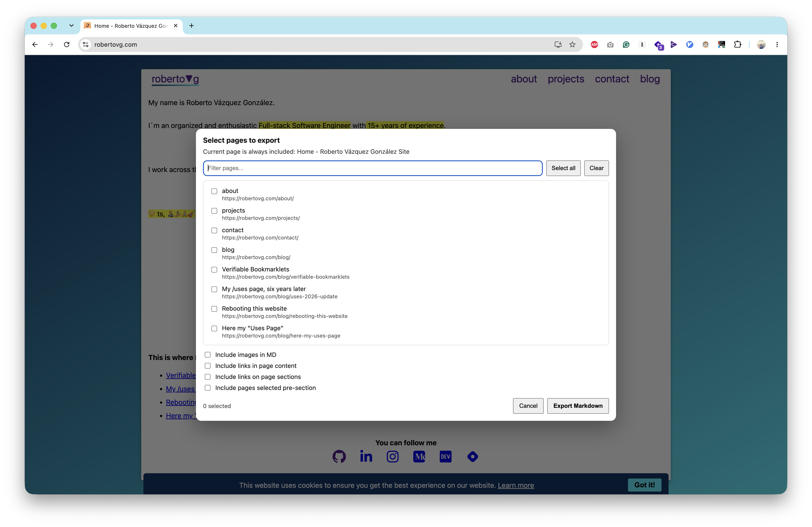
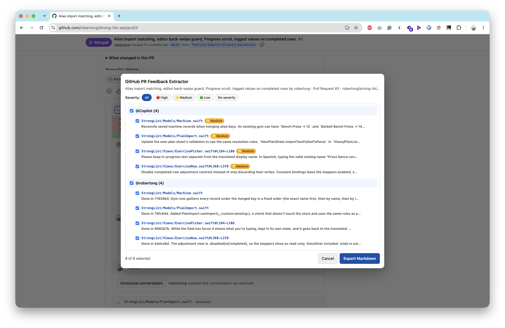

I use MCPs, integrations and skills a lot in my AI workflow. They are incredibly useful. Giving an agent the ability to query a repository, inspect a project, search documentation or interact with another service can turn a simple chat into something much more powerful.

But lately I've also been leaning on something much simpler: small browser snippets that extract the content I am already looking at and put it in my clipboard. No integration, no API, no OAuth flow, no server with access to my account.

Just:

```
I can see it → extract it → paste it into the AI
```

For some of the things I do, that's exactly the interface I want.

## Two snippets

In [Verifiable Bookmarklets](/blog/verifiable-bookmarklets/) I listed the bookmarklets I use every day and said I would expand on one of them in a following post. This is that post. Two of them are built exactly for this workflow.

### 📤 Full Site To Markdown Extractor v1.0.3

It takes the page I'm currently viewing and converts its relevant HTML content into Markdown. That might sound almost too simple, but Markdown is a fantastic format for feeding content to an AI.

If I'm reading an article, a documentation page, an internal tool or any other page I want to discuss with an AI, I don't necessarily need an integration that knows how to access that website. I already have access to it. I can see the page. So I extract it, copy the Markdown and paste it into whatever model I want to use.

If I need more than one page, it can also bundle other pages from the same site that I pick into a single Markdown document, fetched with the session I already have open. Those requests go through my browser, so they are still subject to same-origin rules and the rest of the browser's security restrictions. It doesn't bypass authentication or grant any new access: it can only fetch what I could already open myself.



The source is [public as a Gist](https://gist.github.com/robertovg/c6ed0ef05a3d1d4c958f551c2abb54c8), and you can [generate the bookmarklet from it with Verifiable Bookmarklets](https://robertovg.com/projects/verifiable-bookmarklets/?src=https%3A%2F%2Fgist.githubusercontent.com%2Frobertovg%2Fc6ed0ef05a3d1d4c958f551c2abb54c8%2Fraw%2F0de7d7616583305f1aad920910e922e86c0e266d%2FFull%252520Site%252520To%252520Markdown%252520Extractor%252520-%252520bookmarklet.js).

### 🐙 GitHub PR Feedback Extractor v1.0.0

The second one is more specific. When I'm looking at a GitHub pull request, it collects the review comments on the page and opens a dialog with them grouped by author. I tick the ones I care about and it copies them to my clipboard as a Markdown checklist, keeping the file path and line range of each comment, plus any suggested changes as `diff` blocks. Comments from automated reviewers, like Copilot, can also be filtered by severity.

It only extracts the comments currently rendered on the page and that I select. If a thread is collapsed or not loaded, it isn't included. It structures the feedback, but it doesn't evaluate whether a comment is correct or relevant. That part is still up to me, or to what I ask the model.



PR discussions are exactly the kind of context that makes an AI answer much more useful. Instead of explaining the whole conversation manually, I copy the relevant feedback and ask the model what I want:

- "Here's the PR feedback. What do you think?"
- "What would you change?"
- "Are these comments technically correct?"
- "Help me address these issues."

And again, the important part is that the AI doesn't need GitHub access. I am giving it the content I want it to see. Not needing GitHub API credentials doesn't make a private PR public or automatically safe to share, though. Whatever I select still gets sent to the AI provider I paste it into.

The source is also [public as a Gist](https://gist.github.com/robertovg/27b8a3da1dce1659239a0dfd26a671e5), and you can [generate the bookmarklet from it with Verifiable Bookmarklets](https://robertovg.com/projects/verifiable-bookmarklets/?src=https%3A%2F%2Fgist.githubusercontent.com%2Frobertovg%2F27b8a3da1dce1659239a0dfd26a671e5%2Fraw%2F5943bbc08fdccb79daa21063a12dd20495db81d5%2FGitHub%252520PR%252520Feedback%252520Extractor%252520-%252520bookmarklet.js).

## Client versus server

There is a subtle architectural difference here that I think is worth making explicit.

A bookmarklet runs on the client. The page is already loaded in my browser, and the browser has access to the content because I have access to it. The snippet operates on that page, produces some output, and then I decide what happens next:

```
Private page
     ↓
My browser
     ↓
Bookmarklet
     ↓
Markdown in clipboard
     ↓
AI prompt
```

The AI provider doesn't need credentials for the original service, an API token, or an integration capable of going back to the source. It simply receives the text I explicitly pasted into the conversation.

An integration changes the architecture:

```
Private service
     ↓
Integration / MCP server
     ↓
AI agent
     ↓
Requests more data when it wants it
```

That second model can obviously be extremely powerful. But it also creates a different security boundary. That doesn't necessarily mean unrestricted or autonomous access: the host decides which tools are exposed and with which permissions, and calls may need my approval or be restricted. Still, within those limits, the agent can go back to the source by itself.

## Seeing something doesn't mean an AI should be able to retrieve it

This is the main idea behind these snippets. If I can access some content, that doesn't mean I should grant an AI-controlled server access to my personal account so it can retrieve it. Those are two completely different permissions.

Imagine I am looking at a private GitHub PR. I have access to the repository. That doesn't automatically mean I want an AI agent to have a GitHub token that lets it browse my repositories whenever it wants.

Or my email. I can open my inbox and read an email. That doesn't mean I want an AI integration with permission to search my entire mailbox.

The same applies to other personal services and accounts. An integration might give an agent access to things such as:

- private repository contents
- pull requests and issues
- emails and attachments
- contacts
- calendars
- documents
- personal account information
- financial information
- other private data exposed through an API

There is an important difference between these two statements:

> "The AI can access my GitHub account."

> "I gave the AI the contents of this PR."

The second is a much more explicit boundary. I decide what leaves the source system. I can inspect it before sending it, remove something sensitive, and choose the provider and the model. And when the task is finished, the AI doesn't have a credential that can later be used to retrieve more data.

That's not perfect security. Once I paste something into an AI service, I've obviously shared that content with that service, and its data-handling policies still matter. But the scope of the permission is different. **I am sharing data rather than granting access.**

So the important question isn't simply:

> "Can the AI help me if it has access?"

Of course it can. The question is:

> "Does this particular task justify giving the AI the ability to retrieve that data itself?"

Sometimes the answer is yes. Sometimes it isn't. And I like having both options.

## The strange thing about HTML to Markdown

This is also why the Full Site To Markdown Extractor feels particularly interesting to me. If the browser already has an HTML document, converting it into Markdown is fundamentally a client-side transformation. So requiring a backend just to do this feels strange:

```
HTML → Markdown
```

A backend would mean sending the page somewhere else. That doesn't mean every backend stores or logs it, but now you have another system involved, another trust boundary, and another component whose security and data-handling practices you have to trust.

For a public webpage, perhaps that doesn't matter much. For a private one, it matters considerably more. And the browser already has everything required to perform the transformation, so why send it somewhere else?

The simplest architecture is sometimes also the one with the smallest attack surface.

## This isn't anti-integration

I'm not arguing that integrations or MCPs are bad. Quite the opposite: I use them extensively.

If I am working on a project and I want an agent to inspect the repository, understand the codebase, make changes, run tests and iterate, giving it the appropriate tooling can be incredibly productive. There are tasks where persistent, programmatic access is exactly what you want.

But there are also tasks where I don't need an agent to have access. I just need to give it some context. That's a much smaller permission.

## The clipboard becomes the bridge

This is where my clipboard history becomes surprisingly useful. I basically treat it as a temporary context buffer. One caveat: clipboard managers can keep or synchronize what I copy, sensitive content included, so it's worth knowing where that history is stored.

I extract something once, and then I can try it with ChatGPT, or Claude, or another model, or come back to it later:

```
Private page
      ↓
   Extract
      ↓
   Clipboard
      ↓
 ┌────┼─────┐
 ↓    ↓     ↓
AI A  AI B  AI C
```

Each model receives only the content I explicitly provided. None of them needs credentials for the original service. The source service doesn't need to know which AI I'm using, and I don't have to decide which provider deserves permanent access to my account. I simply choose what context crosses the boundary.

It also makes experimenting with different models much easier. I don't have to install an integration for every provider, give every provider access to my accounts, or build a complicated data pipeline for something that ultimately amounts to:

> "Here is some context. Please help me with it."

## Sometimes the boring solution wins

There is a tendency in AI tooling to solve everything by adding another integration. Need context from GitHub? Add GitHub. From Notion? Add Notion. From email? Add Gmail. From some internal application? Build an MCP server.

And sometimes that's absolutely the right solution. But sometimes the entire requirement is:

> "I'm looking at this thing and I want an AI to understand it."

In that situation, a bookmarklet that converts the page to Markdown and puts it in my clipboard can be a surprisingly good piece of infrastructure:

- It's local.
- It's explicit.
- It's composable.
- It works with different AI providers.
- It doesn't require another backend.

And, most importantly, it doesn't turn "I can access this" into "an AI agent can access this". That distinction is becoming increasingly important as AI agents get more capable.

For me, these snippets aren't replacing MCPs or integrations. They're another permission model. When I want an agent to operate on my data, I give it the appropriate integration. When I just want to give an AI some context, I copy the context.

Sometimes the best integration is still Ctrl+C, Ctrl+V.

<blockquote class='pull-right'>Image by Pexels user <a href='https://www.pexels.com/photo/close-up-shot-of-a-person-s-hand-flipping-through-pages-of-paper-7054418/' target='_blank' rel="nofollow noopener noreferrer">Kindel Media</a> <cite title='Pexels license'>used under the Pexels license.</cite></blockquote>
